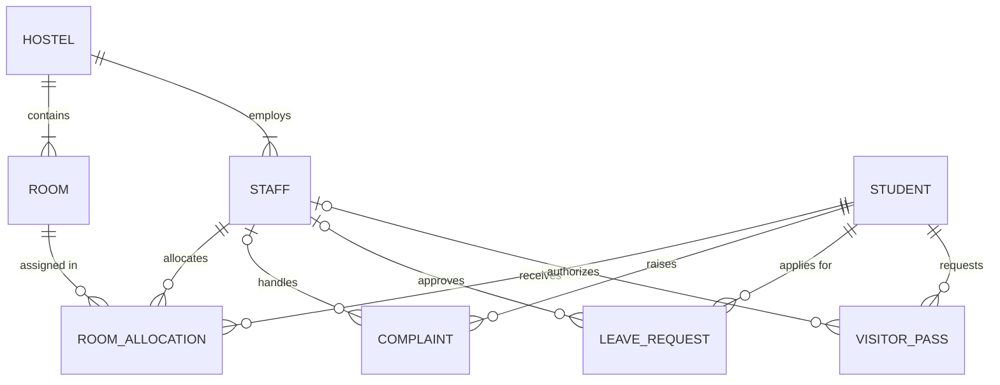

# Database Design

The core relational design is the **8-table schema approved in Review 1** (`docs/review1/`).
Six **extension tables** support Software Engineering modules; they only reference core tables.
Redis is *not* part of the database design (it stores no records — see architecture.md).

## ER diagram (core)

## Relational schema (core)

| Table | Key columns | Main constraints |
|---|---|---|
| HOSTEL(**hostel_id**, hostel_name, gender_type, location, total_floors) | PK hostel_id | UNIQUE name; CHECK gender ∈ {Male, Female}; floors > 0 |
| ROOM(**room_id**, room_number, floor_no, room_type, capacity, occupied_count, *hostel_id*) | FK hostel | UNIQUE(hostel, room_number); CHECK type ∈ {Single…Quad}; capacity matches type; 0 ≤ occupied ≤ capacity; DEFAULT occupied 0 |
| STUDENT(**student_id**, registration_no, name, email, phone, gender, year, branch, cgpa, password_hash) | PK | UNIQUE reg. no., email; CHECK gender, year 1–4, cgpa 0–10 |
| STAFF(**staff_id**, name, role, specialization, phone, email, *hostel_id*, password_hash) | FK hostel | UNIQUE phone, email; CHECK role ∈ {Admin, Warden, Maintenance}; specialization only for Maintenance |
| ROOM_ALLOCATION(**allocation_id**, *student_id*, *room_id*, *allocated_by*, bed_number, allocation_date, vacate_date, status) | FKs student, room, staff | CHECK bed > 0, vacate ≥ allocation, status ∈ {Active, Vacated, Cancelled}; **unique active per student**; **unique active per (room, bed)** |
| COMPLAINT(**complaint_id**, *student_id*, *assigned_to*, category, description, priority, status, created_date, resolved_date, remarks, scheduled_date, image_path, completion_image_path) | FKs student, staff (nullable) | CHECK category, priority, status, resolved ≥ created; DEFAULT priority Medium, status Open |
| LEAVE_REQUEST(**leave_id**, *student_id*, *approved_by*, start_date, end_date, reason, destination, applied_date, status) | FKs | CHECK end ≥ start, status; DEFAULT Pending |
| VISITOR_PASS(**pass_id**, *student_id*, *approved_by*, visitor_name, visitor_phone, relation_to_student, purpose, visit_date, entry_time, exit_time, qr_code, status) | FKs | UNIQUE qr_code; CHECK exit > entry, status; DEFAULT Pending |

Refinements to Review 1 (approved): `password_hash` on STUDENT and STAFF; `scheduled_date`, `image_path`,
`completion_image_path` on COMPLAINT. Constraint tightening: `STAFF.email` NOT NULL (login username),
room type ↔ capacity CHECK, role ↔ specialization CHECK, and the two "one active allocation" rules implemented
as function-based unique indexes.

**Normal form:** every table has a single-column surrogate key and every non-key column depends only on it (3NF).
`ROOM.occupied_count` is the one deliberate derived value — maintained only by `trg_allocation_occupancy`.
Fee status is *not* stored (derived from amounts) to avoid a transitive dependency.

## Extension tables (application modules)

| Table | SE requirement | References |
|---|---|---|
| FEE_PAYMENT | FR-06 fee status & history | STUDENT |
| ANNOUNCEMENT | FR-07 notice board | STAFF (posted_by), HOSTEL (nullable = all) |
| MARKETPLACE_LISTING | FR-08 marketplace | STUDENT (seller, buyer) |
| INVENTORY_ITEM | FR-09 inventory | HOSTEL |
| LOST_FOUND_ITEM | lost & found | STUDENT (reporter, claimant) |
| MESS_MENU | mess menu | HOSTEL; UNIQUE(hostel, day, meal) |

## Feature → database mapping

| Feature | Tables | SQL / PL/SQL |
|---|---|---|
| Login | STUDENT / STAFF (`password_hash`) | SELECT by reg. no. / e-mail |
| Room allocation & vacancy | ROOM_ALLOCATION, ROOM, STUDENT, HOSTEL | `sp_allocate_room`, `sp_vacate_room`, `fn_available_beds`, `fn_find_free_bed`, `trg_allocation_validate`, `trg_allocation_occupancy` |
| Complaints | COMPLAINT, STAFF | `sp_assign_complaint`, `fn_staff_open_workload`, cursor `sp_auto_assign_open_complaints`, `trg_complaint_status` |
| Leave | LEAVE_REQUEST | `sp_decide_leave` |
| Visitor passes & QR | VISITOR_PASS | `trg_visitor_pass_qr` |
| Dashboard & reports | all | `fn_hostel_occupancy_pct`, report queries, cursor `sp_hostel_report` |
| Emergency contacts | STAFF, HOSTEL | SELECT wardens/maintenance per hostel |
| Notifications (in-app) | COMPLAINT, LEAVE_REQUEST, VISITOR_PASS | recent status changes per student |
